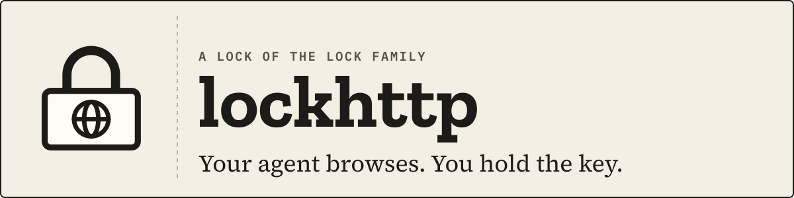

<p align="center">
  <picture>
    <source media="(prefers-color-scheme: dark)" srcset="docs/assets/banner-dark.svg">
    
  </picture>
</p>

<p align="center">
  <a href="https://github.com/DavidGodefroid/lockhttp/actions/workflows/ci.yml"></a>
  <a href="https://github.com/DavidGodefroid/lockhttp/releases"></a>
  <a href="LICENSE"></a>
  <a href="go.mod"></a>
</p>

<p align="center"><b>Let any AI agent use the web: reads of trusted hosts pass,<br>
anything that sends data or reaches an unknown host waits for you.</b></p>

<p align="center">
  
</p>
<p align="center"><sub>An agent (here Claude Code, left, in a lea container) and the approval screen (right). Drawn in the console's frame from before the hub: today you answer in <code>lox run</code>.</sub></p>

<p align="center">
  <a href="#quick-start">Quick start</a> ·
  <a href="#how-it-works">How it works</a> ·
  <a href="#documentation">Docs</a> ·
  <a href="#the-lock-family">Lock Family</a> ·
  <a href="https://lockhttp.com">lockhttp.com</a>
</p>

---

lockhttp is a Lock of the [Lock Family](https://github.com/DavidGodefroid/lockfamily),
harness security for AI agents. It is the proxy every outbound HTTP(S)
request of your agent goes through. Reads of hosts you trust pass; anything
else waits for **your** approval on
[lockhub](https://github.com/DavidGodefroid/lockhub), where the agent cannot reach it.

> [!NOTE]
> **0.x**: the policy format may still change between minor versions. Built on [lockkit](https://github.com/DavidGodefroid/lockkit) v0.14.1.
> Command names are fixed; flags may still move. Design decisions: [docs/decisions.md](docs/decisions.md).

## Why lockhttp

- **Per request, not per domain.** An allowlist lets a host's writes through
  with its reads. lockhttp keeps reads free and holds writes, uploads and
  unknown hosts for a human.
- **Approval outside the agent.** Each held request becomes a `NeverAuto`
  ticket on lockhub, answered by a human in `lox run`. Nothing in the agent's
  process can switch it off.
- **Credentials the agent never holds.** The gate can inject an API token
  for one host and port; a credential sent to the wrong host is refused.
- **Traced.** Every decision is tied to the container, the agent and the
  session that asked.

In-agent approval is a convenience; a separate approval process is a boundary.

## Install

```sh
brew trust davidgodefroid/tap
brew install davidgodefroid/tap/lox davidgodefroid/tap/lockhttp
brew install davidgodefroid/tap/lea
```

lockhttp runs in Docker: Homebrew installs the `lockhttp` launcher, which runs
every command in the release's signed image. `lox` is lockhub's CLI, and the
gate runs inside [lea](https://github.com/DavidGodefroid/lea). The whole
family instead: `brew install davidgodefroid/tap/lockfamily`.

Without Homebrew, the signed install script of a release:

```sh
V=vX.Y.Z
curl -fsSLO "https://raw.githubusercontent.com/DavidGodefroid/lockhttp/$V/scripts/install.sh"
less install.sh
LOCKHTTP_VERSION=$V sh install.sh
```

Linux and macOS; on Windows, WSL 2 with Docker Desktop. The launcher, its
commands and the setup by hand: [docs/install.md](docs/install.md).

## Quick start

1. In lea's projects directory, add the lock. `lox add lockhttp` asks only
   for its name, writes the policy and starts the console:

   ```sh
   cd ~/projects
   lox add lockhttp
   ```

2. In a terminal of its own, outside lea and any agent, keep `lox run` open.
   Every held request shows up there:

   ```sh
   lox run
   ```

3. Turn lockhttp on in lea's configuration, then restart lea.
   `LEA_LOCKHTTP=1 lea` is not enough: lea's configuration wins over the
   environment.

   ```sh
   echo LEA_LOCKHTTP=1 >> ~/.config/lea/lea.conf
   lea stop --all
   lea
   ```

   lea-proxy and its gate are shared by every lea on the machine: lockhttp is
   on or off for all of them at once, and once it is on, a lea whose projects
   directory has no lockhttp lock does not start. `lea doctor` reports
   the gate's state.

4. Ask your agent to read the docs of a trusted site: it goes through. Ask
   it to post somewhere: the request waits for your `y`.

lockhttp is a proxy, so it works with any agent and any HTTP client inside
lea's containers (lea runs Claude Code today). The contract with lea:
[docs/lea.md](docs/lea.md).

## Highlights

<table>
<tr>
<td width="50%" valign="top">

**👤 Never answered automatically**<br>
Every held request is a `NeverAuto` ticket: a human answers it. Only a
`free` rule you confirmed lets a request pass unasked.

</td>
<td width="50%" valign="top">

**🔑 Credentials injected**<br>
A policy `inject` entry has the gate add an `Authorization` header from its
own secrets file. The agent never holds the token.

</td>
</tr>
<tr>
<td valign="top">

**🔁 LLM APIs checked as a relay**<br>
With TLS decryption, the Claude API's `mcp_servers`, server tools and Files
API wait for a human; plain messages pass.

</td>
<td valign="top">

**🧱 Fail closed**<br>
No console: asks are refused at once. Unknown source, undecodable policy, an
error while deciding: deny.

</td>
</tr>
</table>

More: [the verdicts, refusal codes and the Claude API rules](docs/how-it-works.md),
and [the policy keys](docs/configuration.md). A company bounds lockhttp
with the Lock Family's [managed configuration](https://github.com/DavidGodefroid/lockfamily/blob/main/docs/managed.md)
([lockhttp's section](docs/configuration.md#managed-configuration)).

## How it works

Three pieces, each in a container of its own, and the hub.

```
 agent container (internal network only)
        │ HTTP(S)_PROXY
        ▼
 lockhttp gate  ── FREE ──▶ squid ──▶ Internet
        │ ASK                ▲
        ▼                    │ on y
 lockhub ── ticket ──▶ you, in lox run
        ·
 lockhttp console: serves the approved policy to the gate
```

1. The agent's HTTP client sends every request to the **gate**. In lea the
   agent's container has no other route out.
2. The gate decides each request with the policy the **console** serves it.
   It never reads a policy file.
3. A free request goes out through squid. A request that needs a human is
   held (60 s by default) as a signed ticket on the hub.
4. With a local CA and the **signer**, the gate decrypts HTTPS and decides
   each request by method, path, headers and body. Without them, it decides
   a `CONNECT` at the domain only.

The full diagram, verdicts, refusal codes, the Claude API checks and the
limits: [docs/how-it-works.md](docs/how-it-works.md).

## Safety model

- **The gate is the enforcement point.** The console is the only place the
  policy loosens; the hub's facades the only place a request is approved.
- **OS separation.** The console runs as its own account in its own
  container; the kernel checks the gate's uid on its socket.
- **Confined agents only.** An agent that does not run confined (outside
  lea, or with the host's container runtime in reach) is refused, at the
  console and at the gate, unless a non-production profile sets
  `unconfined = true` ([docs/policy.md](docs/policy.md#confined-agents)).
- **The AI tightens, the human loosens.** Any change that widens what passes
  without a human waits for your `:review` in the console.
- **Audit.** The gate's JSONL log and the console's audit share a
  `request_id`, never a body, a query string or a header value.
- **Known limits.** Without decryption a `CONNECT` opens reads and writes,
  and whoever can run `docker` can reach the console's container.

Every rule: [docs/safety.md](docs/safety.md). Threat model:
[docs/security-model.md](docs/security-model.md).

## Documentation

| Doc | What it covers |
|---|---|
| [docs/install.md](docs/install.md) | install paths, the launcher's commands, the setup with lea by hand |
| [docs/how-it-works.md](docs/how-it-works.md) | the pieces, verdicts, what the agent sees, the Claude API checks, limits |
| [docs/configuration.md](docs/configuration.md) | the policy file, every profile key, policy examples, the company's managed configuration |
| [docs/policy.md](docs/policy.md) | the policy reference: evaluation order, credential injection, shadow mode, loosenings |
| [docs/usage.md](docs/usage.md) | every command and flag, exit codes, files, audit records |
| [docs/docker.md](docs/docker.md) | the image, its accounts and volumes, update, migrating from a host install |
| [docs/lea.md](docs/lea.md) | the integration contract with lea |
| [docs/safety.md](docs/safety.md) | the safety model in full |
| [docs/security-model.md](docs/security-model.md) | threats, parades, residual risks |
| [docs/decisions.md](docs/decisions.md) | design decisions |
| [CHANGELOG.md](CHANGELOG.md) | what changed, release by release |

The site, [lockhttp.com](https://lockhttp.com), is built from [`site/`](site/).

## The Lock Family

| Repo | What it does |
|---|---|
| [lockfamily](https://github.com/DavidGodefroid/lockfamily) | The family site ([lockfamily.dev](https://lockfamily.dev)) and the one-line installer. |
| [locksql](https://github.com/DavidGodefroid/locksql) | SQL databases: the agent queries, PII comes back masked; connections and writes wait for you. |
| [lockmq](https://github.com/DavidGodefroid/lockmq) | RabbitMQ: masked queue inspection; connections, peeks and unmasked reads wait for you. |
| [lockfile](https://github.com/DavidGodefroid/lockfile) | Files (S3, SFTP, disk): the agent asks yes/no questions about files it never reads. |
| [lockhttp](https://github.com/DavidGodefroid/lockhttp) | Outbound HTTP(S): reads of trusted hosts pass; anything that sends data or reaches an unknown host waits for you. |
| [locklog](https://github.com/DavidGodefroid/locklog) | Logs: masked, bounded log search; the agent reads the logs, not the people in them. |
| [lockssh](https://github.com/DavidGodefroid/lockssh) | Commands over SSH: allow-listed commands run at once, the rest waits for you; the key never leaves the console. |
| [lockhub](https://github.com/DavidGodefroid/lockhub) | The approval hub and its `lox` CLI: `lox run` approves outside the agent's harness and never sees values in clear. |
| [lockkit](https://github.com/DavidGodefroid/lockkit) | The shared Go core of every Lock: console, policies, masking, signed tickets, audit, MCP. |
| [lea](https://github.com/DavidGodefroid/lea) | Runs many agents in containers, wired to the Locks. |

## Contributing · Security · License

- **Contributing:** [CONTRIBUTING.md](CONTRIBUTING.md). Build with
  `CGO_ENABLED=0 go build ./cmd/lockhttp` (Go 1.26+).
- **Docs:** docs are published at
  [lockfamily.dev/docs](https://lockfamily.dev/docs/) from this repo's
  Markdown. Adding a file under `docs/`, or renaming or removing a README H2
  section, needs a matching change to
  [lockfamily's `docs-site/nav.toml`](https://github.com/DavidGodefroid/lockfamily/blob/main/docs-site/nav.toml):
  open a lockfamily PR, or the nightly docs build fails.
- **Security:** report a vulnerability privately, see [SECURITY.md](SECURITY.md).
- **License:** Apache License 2.0, see [LICENSE](LICENSE) and [NOTICE](NOTICE).
