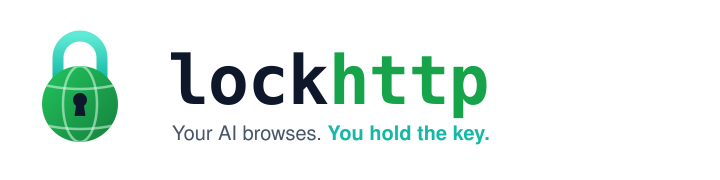

<p align="center">
  <picture>
    <source media="(prefers-color-scheme: dark)" srcset="site/assets/banner-dark.svg">
    
  </picture>
</p>

<p align="center">
  <a href="https://github.com/DavidGodefroid/lockhttp/actions/workflows/ci.yml"></a>
  <a href="https://github.com/DavidGodefroid/lockhttp/releases/latest"></a>
  
  <a href="LICENSE"></a>
</p>

<p align="center">
  <b>Let your AI agents use the web<br>
  without letting them send anything out behind your back.</b>
</p>

<p align="center">
  
</p>

<p align="center">
  <a href="#quick-start-with-lea">Quick start</a> ·
  <a href="#how-it-works">How it works</a> ·
  <a href="#security-model">Security model</a> ·
  <a href="#configuration">Configuration</a> ·
  <a href="#install">Install</a> ·
  <a href="docs/usage.md">Docs</a> ·
  <a href="https://lockhttp.com">Website</a>
</p>

---

LockHTTP is the proxy every outbound HTTP(S) request of an AI agent goes
through. Reads of hosts you trust pass. Anything that sends data, triggers an
action or reaches an unknown host waits for **your** approval, in a console
that runs in its own container under its own account, where the agent
cannot reach it. Every decision is traced to the container, the agent and the session
that asked.

> [!NOTE]
> **Pre-release** (`v0.3.0`). Built on [lockkit](https://github.com/DavidGodefroid/lockkit) v0.3.1.
> Design decisions: [docs/decisions.md](docs/decisions.md).

## Why LockHTTP?

An agent that can read the web can also write to it: a `POST` to a webhook,
a `git push`, a package publish, a secret tucked into a query string, a
Claude API call that hands an MCP server to the model. An allowlist of
domains does not tell these apart from a documentation read, and approval
prompts inside the agent's own process can be configured away by that
process.

LockHTTP moves the decision out of the agent and onto the network path:

| | Domain allowlist | In-agent approval | LockHTTP |
|---|:---:|:---:|:---:|
| Reads of trusted hosts pass without a prompt | ✅ | ✅ | ✅ |
| A write to a trusted host still needs a human | ❌ | ✅ | ✅ (per request when decrypting) |
| Approval cannot be switched off from the agent side | ✅ | ❌ | ✅ |
| Policy loosening needs a human confirmation | ❌ | ❌ | ✅ |
| Secrets sent to the wrong host are refused | ❌ | ❌ | ✅ (when decrypting) |
| Claude API relays (`mcp_servers`, server tools, Files) need a human | ❌ | ❌ | ✅ (when decrypting) |
| Each decision traced to container, agent, task | ❌ | ❌ | ✅ |

## How it works

Three pieces, each in a container of its own. Only the console decides what
needs a human, and only the human answers.

```
 agent container  (internal network only, no route out)
   HTTP(S)_PROXY=http://<agent>:<token>@lea-proxy:3130
          │
          ▼
 gate container   (shares the proxy container's network)
   lockhttp gate :3130   (uid 10003 "gate", never root)  ──▶  squid 127.0.0.1:3128  ──▶  Internet
   lockhttp signer       (its own container, uid 10004, holds the CA key; only with decryption)
          │  volume lockhttp-run: /run/lockhttp/user-<profile>.sock
          │  (gate and console only; peer uid checked by the kernel)
          ▼
 console container  "lockhttp-console"   (lockhttp console, your terminal)
   uid 10021 "lockhttp" · volume lockhttp-home: the policy, the approved policy, the audit
   shows approval screens · serves the approved policy to the gate
```

1. The agent's HTTP client sends every request to the **gate**, a Go
   HTTP(S) proxy. In [lea](https://github.com/DavidGodefroid/lea) the agent's
   container has no other route out: the proxy variables are a convenience,
   the network is the boundary.
2. The gate decides each request with the policy the **console** serves it
   (`policy.get`, polled every 2 s). It never reads a policy file.
3. A request that is free goes out through squid, which keeps its own floor
   (DoH, IP literals, private ranges, ports). A request that needs a human
   is held (60 s by default) while the console shows you an approval screen.
4. With a local CA and the **signer**, the gate decrypts HTTPS and decides
   each request by method, path, headers and body. Without them, it decides
   a `CONNECT` at the domain only (see [Limits](#limits)).

### Verdicts

| Verdict | What happens |
|---|---|
| **FREE** | The request goes out. The gate audits it (JSONL, one file per day). |
| **ASK** | The gate holds the request and asks the console. You answer `y` or `n <reason>`. Only a rule with `verdict = "auto"` can let the console's auto mode answer; every other screen is `NeverAuto`. |
| **DENY** | `403` with an `X-LockHTTP-Code` header, at once. |

What an ASK becomes depends on what the gate sees:

- **A `CONNECT` decided at the domain** (no decryption, or a spliced or
  internal host): `y` opens *container × host × port* for `connect_grant`
  (10 minutes by default), **for reads and writes**, content unseen. The
  screen says so.
- **A decrypted or plain HTTP request**: `y` approves that request. If the
  agent's client already gave up (hold time passed, `E_PENDING`), `y` creates
  a single-use authorisation for the identical request, valid 10 minutes.
- **Durable openings** are policy rules, which you write and confirm in the
  console's `:review`.

Requests are approved one at a time. Requests of identical fingerprint
(container, method, URL, media type, every end-to-end header,
normalised body) share one screen and one decision; a request to
the same URL with another body is a separate screen.

## Quick start with lea

LockHTTP runs in Docker: nothing on your machine but Docker and the
`lockhttp` launcher, which runs every command in the image
`ghcr.io/davidgodefroid/lockhttp`, each as the account it needs.
[lea](https://github.com/DavidGodefroid/lea) runs the gate beside its proxy
container when `LEA_LOCKHTTP=1`. The contract between the two (files,
mounts, uids, network rules) is in [docs/lea.md](docs/lea.md).

```sh
# 1. Install the launcher (see Install)
V=vX.Y.Z
curl -fsSLO "https://raw.githubusercontent.com/DavidGodefroid/lockhttp/$V/scripts/install.sh"
less install.sh && LOCKHTTP_VERSION=$V sh install.sh

# 2. The policy (lea's allowlist as trusted reads), then the console
lockhttp init --trusted "<LEA_EGRESS_ALLOW>"
lockhttp console                               # in a terminal you keep in view

# 3. In another terminal: start lea with LockHTTP on
export LEA_LOCKHTTP=1
```

The console runs as the `lockhttp` account (uid 10021) in the container
`lockhttp-console`, the only one with the policy volume `lockhttp-home`.
lea's gate runs as `gate` (uid 10003) in a container of its own and shares
only the socket volume `lockhttp-run` with the console.

## Quick start standalone (one host)

Without lea, the gate runs in its own container and publishes
`127.0.0.1:3130`. Every connection is attributed to the container `local`.

```sh
lockhttp init
lockhttp console           # in a terminal you keep in view

lockhttp gate              # in another terminal
HTTPS_PROXY=http://127.0.0.1:3130 HTTP_PROXY=http://127.0.0.1:3130 your-agent
```

In this setup the proxy variables are the only thing that sends the agent
through the gate: an agent that ignores them goes straight out. Standalone
mode is useful to try the policy and the console; it is a boundary only if
the agent's sole route to the network is the gate.

## Install

LockHTTP runs in Docker. On the host, `scripts/install.sh` installs only the
`lockhttp` launcher, a shell script that runs every command in the release's
image (`ghcr.io/davidgodefroid/lockhttp:X.Y.Z`, amd64 and arm64). Download
the script from the release you install, read it, then run it:

```sh
V=vX.Y.Z
curl -fsSLO "https://raw.githubusercontent.com/DavidGodefroid/lockhttp/$V/scripts/install.sh"
less install.sh
LOCKHTTP_VERSION=$V sh install.sh
```

It verifies the keyless cosign signature of `checksums.txt` against this
repository's release workflow, checks the archive, verifies the image's
cosign signature and writes its digest into the launcher, which runs the
image by that digest. The launcher lands in `/usr/local/bin`, root-owned
(`LOCKHTTP_INSTALL_DIR` to change it). cosign is required unless
`LOCKHTTP_SKIP_COSIGN=1`, which verifies nothing and runs the image by its
tag. Linux (Docker Engine) and macOS (Docker Desktop); on Windows, WSL 2
with Docker Desktop.

| Command | Runs as | What it does |
|---|---|---|
| `lockhttp init` | `lockhttp`, volume `lockhttp-home` | Writes the policy `~/.config/lockhttp/config.toml`, profile `default`. |
| `lockhttp policy show\|edit\|path` | `lockhttp`, volume `lockhttp-home` | Prints, edits or locates the policy. |
| `lockhttp console` | `lockhttp`, container `lockhttp-console` | The approval console. It must run in a terminal. |
| `lockhttp gate` | `gate`, container `lockhttp-gate` | The proxy, for standalone use, published on `127.0.0.1:3130`. |
| `lockhttp doctor [--gate ADDR] [--ca-cert FILE]` | `lockhttp` | Separated setup, policy, CA, gate. |
| `lockhttp version`, `lockhttp update [vX.Y.Z]` | | The launcher's and the image's versions; a newer release's launcher, checked the same way, and its image. |

`LOCKHTTP_IMAGE` runs an image of your own (`docker build -t lockhttp .`
from a clone), `LOCKHTTP_DOCKER_ARGS` adds `docker run` arguments. There is
no host install: the image refuses `lockhttp install`. Coming from v0.1.0's
`sudo lockhttp install`: [migrating from a host
install](docs/docker.md#migrating-from-a-host-install).

The demo above is generated by [`scripts/brand/demo.py`](scripts/brand/demo.py):
`python3 scripts/brand/demo.py > site/assets/demo.svg`.

Accounts, volumes, the exact `docker run` of each command, and what Docker
does and does not separate: [docs/docker.md](docs/docker.md). Every command
and flag: [docs/usage.md](docs/usage.md).

## Configuration

The policy lives in the console account's `~/.config/lockhttp/config.toml`,
one table per profile. The console reads it, reloads it when it changes,
and holds every change that loosens it until you confirm it with `:review`.
Unknown keys and keys that look like secrets are refused.

```toml
[profiles.default]
mode          = "enforce"   # enforce | shadow
heuristics    = "shadow"    # off | shadow | enforce
buffer_limit  = "10MiB"     # largest body held for a human
hold          = "60s"       # how long a request waits for the human (max 5m)
connect_grant = "10m"       # how long an approved CONNECT opens its host
trusted = ["go.dev", "pkg.go.dev", "github.com", "api.github.com"]
splice  = []                # never decrypted (certificate pinning)
deny    = []                # always refused
```

<details>
<summary>All profile keys</summary>

| Key | Default | Notes |
|---|---|---|
| `production` | `false` | No rule may be `auto`, and the console treats the profile as production. |
| `mode` | `enforce` | `shadow`: what would ask or be denied passes and is logged as such. |
| `heuristics` | `shadow` | Exfiltration score: `off` (not computed), `shadow` (logged), `enforce` (a score ≥ 3 asks, `NeverAuto`, red). |
| `buffer_limit` | `10MiB` | `B`, `KiB`, `MiB`, `GiB` or bytes; more than 0. |
| `hold` | `60s` | Go duration, at least `1s`, at most `5m`. |
| `connect_grant` | `10m` | At least `1s`. |
| `idle_timeout` | `24h` | Console session limit. |
| `max_session` | `24h` | Console session limit. |
| `trusted` | `[]` (`init` writes a docs set) | Reads (`GET`, `HEAD`, `OPTIONS` without body) are free. |
| `splice` | `[]` | Never decrypted: decided at the domain. |
| `deny` | `[]` | Always refused (`E_RULE`). |
| `redirect_cdn` | `[]` | `"origin>cdn"`: a 3xx from origin to cdn lets the same container `GET` that exact URL once within 60 s. Eight GitHub, Docker, Go and PyPI pairs are built in. |
| `[[profiles.P.internal_hosts]]` | none | `host`, `ports` (required), `read` (`false`). May resolve to a private address. |
| `[[profiles.P.rules]]` | none | `id`, `container`, `host`, `methods`, `path`, `verdict`, `max_body`, `expires`, `note`. |

</details>

Hosts are names: `example.com`, or `*.example.com` for its subdomains (not
`example.com` itself). IP literals are refused. The full reference, with
the evaluation order and what counts as a loosening, is in
[docs/policy.md](docs/policy.md).

### Policy examples

```toml
[profiles.default]
trusted = ["docs.rs", "*.readthedocs.io"]       # free reads of docs
splice  = ["pinned.example.com"]                # a client that pins its certificate
deny    = ["pastebin.com"]

# A container-scoped rule that auto mode may answer
[[profiles.default.rules]]
id        = "npm-audit"
container = "lea-ab12cd34ef"
host      = "registry.npmjs.org"
methods   = ["POST"]
path      = "/-/npm/v1/security/advisories/bulk"
verdict   = "auto"
max_body  = "256KiB"
expires   = "2026-12-31"

# Every write under an API path asks (NeverAuto), even on a trusted host
[[profiles.default.rules]]
id      = "issues-write"
host    = "api.github.com"
methods = ["POST", "PATCH"]
path    = "/repos/acme/shop/issues*"
verdict = "ask"

# Refuse a host for every container
[[profiles.default.rules]]
id      = "no-gists"
host    = "gist.github.com"
verdict = "deny"

# An internal host on a private address: free reads on 8443
[[profiles.default.internal_hosts]]
host  = "git.corp.example"
ports = [8443]
read  = true
```

To try a policy before enforcing it, set `mode = "shadow"`: what would ask
or be denied passes and is audited with `"decision": "shadow-ask"` or
`"shadow-deny"`. The floor and secret matches stay enforced.

## What the agent sees

A refusal is a `403 Forbidden` with a plain-text body that says why and
what to ask of the human, and two headers: `X-LockHTTP-Code` and
`X-LockHTTP-Request` (the id to find in the console and the audit). For a
`CONNECT` it is the `CONNECT`'s own response, which clients show as a proxy
error. A forwarded response carries `X-LockHTTP-Request` too (decrypted or
plain HTTP); a target the gate cannot reach is a `502`.

| Code | Meaning | What the agent should do |
|---|---|---|
| `E_PENDING` | The request waits for the human past the hold time. | Retry the same request in a moment: once approved it goes through. |
| `E_NO_CONSOLE` | No console is running: every ASK is refused at once. | Ask the user to run `lockhttp console`. |
| `E_DENIED` | The human denied it (the reason is in the body). | Do not retry; ask the user. |
| `E_TIMEOUT` | Nobody answered the approval in time. | Ask the user to watch the console. |
| `E_RULE` | A deny rule or the deny list refuses it. | Ask the user to change the rule. |
| `E_FLOOR` | The network floor: IP literal, DoH, cloud metadata, port, single-label host, SNI or Host mismatch, `h2c`, nested `CONNECT`, a non-absolute URL. | Use a named public host on 80 or 443. |
| `E_SECRET_EGRESS` | A known credential sent outside its own hosts, or a Claude credential that is not the container's. | Never send a credential to another host. |
| `E_BODY_TOO_LARGE` | The body is over `buffer_limit` and cannot be held for a human. | Send less, or ask for a rule. |
| `E_SOURCE_UNKNOWN` | The gate cannot tell which container sent the request. | Use the proxy address lea gave. |

`E_HOST_UNKNOWN`, `E_CLAUDE_API_PARAM`, `E_EXFIL_SUSPECT`, `E_METHOD` and
`E_PINNED` are registered codes too; in v0.1.0 a refused ASK reaches the
agent as `E_DENIED`, `E_TIMEOUT`, `E_PENDING` or `E_NO_CONSOLE`, and
`E_PINNED` appears in the gate's audit only (a client that rejects the
gate's certificate closes the connection before any response).

## Claude API allowlist

The four hosts Claude Code reaches (`api.anthropic.com`, `claude.ai`,
`console.anthropic.com`, `statsig.anthropic.com`) are free at the domain.
Any other host under `anthropic.com`, `claude.ai` or `claude.com` asks
(`NeverAuto`), unless a rule says otherwise.

Once TLS is decrypted, the Claude API is a generic relay and is checked per
request:

| Request | Verdict |
|---|---|
| `POST /v1/messages`, `/v1/messages/count_tokens` | FREE only when the body is one unambiguous JSON object with no `mcp_servers`, no `container`, and no server tool other than `web_search` (custom tools and the client-run `bash`, `text_editor`, `computer`, `memory` are fine). Otherwise ASK, red, `NeverAuto`. |
| OAuth paths (`/v1/oauth/`, and `/oauth/` on `claude.ai`) | FREE |
| `/v1/files*` | ASK, `NeverAuto` |
| Other reads on the four hosts | FREE |
| Other writes | ASK, `NeverAuto` |
| A credential (`Authorization`, `x-api-key`) not in the caller's list, or two credentials | DENY `E_SECRET_EGRESS` (with lea's `credentials.json`) |

Duplicate keys, and keys that differ from `mcp_servers`, `tools` or
`container` only by case, make the body ambiguous: it asks.

## Security model

The gate is the enforcement point on the network path; the console is the
only place a human decision is made. In short:

- **The console is in its own container, under its own account.**
  `lockhttp console` runs as `lockhttp` (uid 10021) in the container
  `lockhttp-console`, without a log driver, the only container with the
  policy volume `lockhttp-home`. Its socket is reachable only by the
  `lockhttp-clients` group (the image's `gate` account), checked with the
  kernel's peer credentials, and the socket volume `lockhttp-run` is mounted
  in the gate's container only, never in an agent's. Anyone who can run
  `docker` on the host can reach the console's container and volumes: keep
  the agent away from the Docker socket.
- **NeverAuto by default.** Every approval screen is `NeverAuto` unless the
  request matched an active rule with `verdict = "auto"`. Such a rule names
  a container or none, never an agent, and is refused on messaging hosts,
  registry publishing, `git-receive-pack`, a write to any path of a git
  forge, spliced hosts, every-host rules and production profiles. At run
  time uploads, messaging, publishing, git pushes, WebSockets, `CONNECT`s,
  red screens and heuristic hits stay `NeverAuto`; secrets are denied. The
  console re-checks the gate's claim against its own approved policy (rule
  id, active, `auto`, host, method, path, container, `max_body`) before auto
  mode may answer.
- **A decision is shared only by identical requests.** Same container,
  method, URL, significant headers and normalised body; anything else is
  its own screen.
- **Fail closed.** No console: every ASK is refused at once
  (`E_NO_CONSOLE`), while FREE goes on with the last policy the console
  served. Unknown source, unreadable source map: refused. An unreadable
  credentials file: every Claude credential is denied. A policy whose
  fingerprint does not match: the previous one is kept.
- **The gate never reads a policy.** It uses what the console serves, and
  checks it against the console's fingerprint.
- **The signer holds the CA key.** The gate asks `lockhttp signer` for a
  24-hour leaf per host, over a Unix socket restricted to allowed uids; it
  never sees the CA key.
- **The AI tightens, the human loosens.** Any change that widens what passes
  without a human (a trusted host, a `free` or `auto` rule, shadow mode, a
  longer grant, a removed deny...) waits for your `:review`.
- **Traced.** The gate's JSONL audit and the console's audit carry
  `request_id`, `container`, `agent`, `attribution`, `via`, never a body, a
  query string or a header value.

Threats, parades and residual risks: [docs/security-model.md](docs/security-model.md).

## Limits

- **Without decryption, a `CONNECT` opens reads AND writes.** A trusted host
  is free at the domain, and an approved `CONNECT` opens its host for
  `connect_grant`; the gate does not see what goes through. Rules with
  `methods` or `path` cannot apply at the domain. The Claude API allowlist
  needs decryption too. `lockhttp doctor` warns when no CA is given.
- **HTTP/1.1 only to clients when decrypting.** The gate offers ALPN
  `http/1.1`; it does not speak HTTP/2 to clients, and refuses `Upgrade: h2c`.
- **A WebSocket session is one approval.** The upgrade request is decided;
  the frames that follow are not.
- **Heuristics run in shadow by default.** The exfiltration score is logged,
  not enforced, until you set `heuristics = "enforce"`.
- **One human per installation, one approval at a time.** The console is
  serial; the gate queues its asks.
- **The agent name is declarative.** The container is read from the network
  the connection arrived on; the agent name comes from `Proxy-Authorization`
  and is for the audit only. Agents of one container share a uid, so rules
  scope to containers, never to agents.
- **Standalone mode is not a boundary** unless the agent's only route out is
  the gate.
- No MCP server in v0.1.0: agents meet LockHTTP as a proxy, and its `403`
  pages tell them what to ask of the human.

## The Lock family

LockHTTP is one of a family of human-gated tools for AI agents, built on the
same console, separation and approval model:

| Project | Gates access to |
|---|---|
| [locksql](https://github.com/DavidGodefroid/locksql) | databases: MariaDB, MySQL, PostgreSQL, SQLite |
| [lockmq](https://github.com/DavidGodefroid/lockmq) | message queues: RabbitMQ |
| [lockfile](https://github.com/DavidGodefroid/lockfile) | files: yes/no answers about a file the agent never reads |
| **lockhttp** | outbound HTTP(S): the web, APIs, registries, the Claude API |
| [lockkit](https://github.com/DavidGodefroid/lockkit) | the shared Go framework: console, separation, approval, masking, audit |

Website: [lockhttp.com](https://lockhttp.com).

## Documentation

| | |
|---|---|
| [docs/docker.md](docs/docker.md) | the launcher, the image, its accounts and volumes, install, update, migrating from a host install |
| [docs/usage.md](docs/usage.md) | every command and flag, exit codes, files |
| [docs/policy.md](docs/policy.md) | the policy reference, evaluation order, shadow mode, loosenings |
| [docs/security-model.md](docs/security-model.md) | threats, parades, residual risks |
| [docs/lea.md](docs/lea.md) | the integration contract with lea |
| [docs/decisions.md](docs/decisions.md) | design decisions of v0.1.0 |
| [SECURITY.md](SECURITY.md) | reporting a vulnerability, verifying a release and the image |
| [CHANGELOG.md](CHANGELOG.md) | release notes |

## Licence

Apache License 2.0. See [LICENSE](LICENSE) and [NOTICE](NOTICE).
